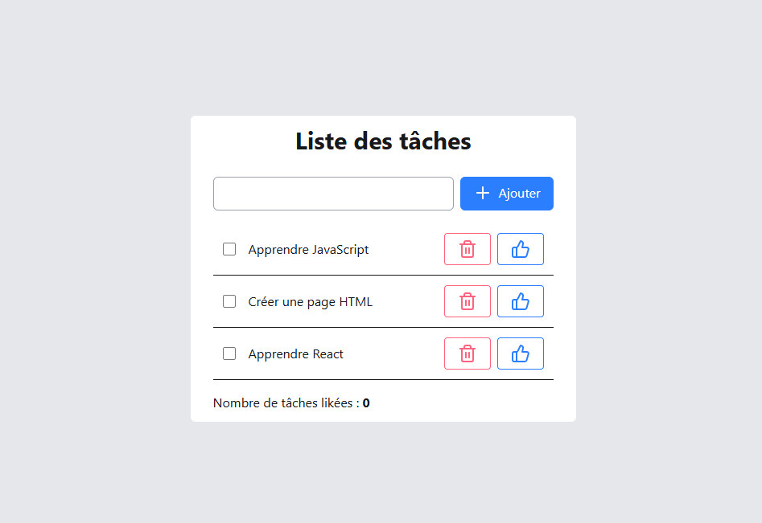

# 📝 Liste des tâches (To-Do List) — WEB 3.0 ACADEMY

> Une application de gestion de tâches interactive, moderne et responsive, conçue pour maîtriser les fondamentaux du développement web moderne et la création d'interfaces utilisateur fluides.

---

## 📸 Aperçu du projet

<div align="center">
  
</div>

---

## 🚀 À propos du projet

Cette **To-Do List** a été développée dans l'objectif de créer une interface utilisateur engageante tout en mettant en pratique une stack technique moderne et performante. Elle permet à l'utilisateur de :

- ➕ **Ajouter des tâches** en temps réel via un champ de saisie intuitif.
- 🗑️ **Supprimer des tâches** obsolètes en un clic.
- 👍 **Liker des tâches** pour marquer leur importance, avec un compteur dynamique en bas de page.
- ✅ **Suivre l'état** grâce à des cases à cocher interactives.

---

## 🛠️ Stack Technique

<p align="left">
  <!-- React JS -->
  <a href="https://reactjs.org/" target="_blank" rel="noreferrer">
    
  </a>
  &nbsp;&nbsp;
  <!-- Tailwind CSS -->
  <a href="https://tailwindcss.com/" target="_blank" rel="noreferrer">
    
  </a>
  &nbsp;&nbsp;
  <!-- DaisyUI -->
  <a href="https://daisyui.com/" target="_blank" rel="noreferrer">
    
  </a>
  &nbsp;&nbsp;
  <!-- Lucide React -->
  <a href="https://lucide.dev/" target="_blank" rel="noreferrer">
    
  </a>
</p>

_L'application est bâtie sur **React.js**. Le style et la mise en page sont gérés par **Tailwind CSS**, accélérés par les composants pré-stylisés de **DaisyUI**. Les icônes proviennent de la bibliothèque **Lucide React**._

---

## ⚙️ Installation et Démarrage

Pour exécuter ce projet en local sur votre machine, suivez ces étapes :

### Prérequis

Assurez-vous d'avoir **Node.js** (et **npm** ou **yarn**) installé sur votre ordinateur. Vous pouvez le télécharger [ici](https://nodejs.org/).

### Procédure

1. **Cloner le dépôt :**
   Ouvrez votre terminal et lancez la commande suivante pour télécharger le code source :
   ```bash
   git clone [https://github.com/tchoupo237/liste-des-taches.git](https://github.com/tchoupo237/liste-des-taches.git)
   ```
